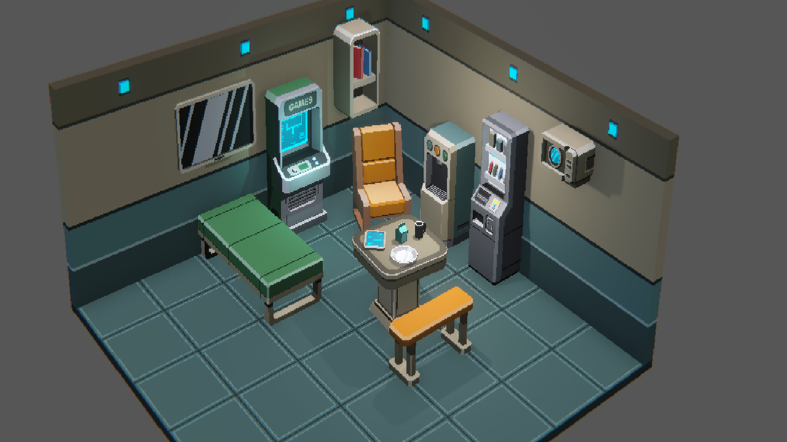
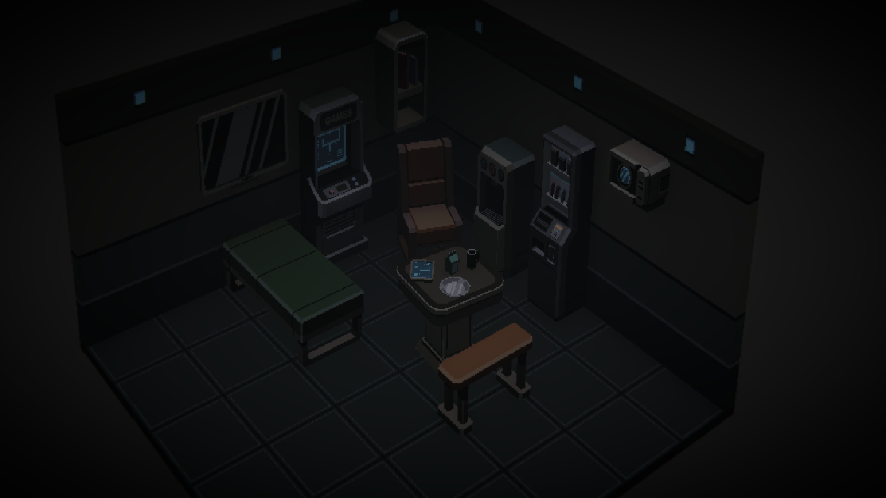

# Unity Mood Lighting Agent

An agent that takes a single natural-language mood prompt (`"apply a
post-apocalyptic mood"`) and changes an **existing** Unity scene's lighting
and rendering to match it — lights, color grading, vignette, fog, skybox —
without a human manually placing anything, and without touching scene
geometry or props.

```
Prompt: "apply a post-apocalyptic mood"
     ↓
Lighting agent reads the scene (objects, current lighting state, a live
screenshot) → decides what to change → calls tools (lights, color grading,
vignette, fog, skybox) → a judge agent scores the result against the mood
→ passes, or retries with the judge's own feedback, up to 3 attempts
```

## See it in action

| Before | After (`"apply a post-apocalyptic mood"`) |
|---|---|
|  |  |

## Status

**9/10 test moods passing**, using lighting and rendering only, no scene
geometry changes. Full scoring data, every tuning change made and its
measured effect, and the one still-open case: `docs/mood-test-results.md`.

**Product scope, locked in (2026-11-20):** lighting and rendering control
only — lights, post-processing, skybox/HDRI, exposure, fog. Scene geometry
and props are explicitly out of scope, not a later phase. A mood that
implies objects the scene doesn't have (e.g. "festive" implying
decorations) gets sold through atmosphere alone — color, contrast, shadow
shape — not by adding anything.

## How it works

Two separate agents, not one:

- **Lighting agent** (`agent.py`) — a tool-calling agent, no structured
  output. Gets the current scene state (objects, bounds, current
  post-processing values, a live screenshot) and decides what to change.
  Tools: move/create/aim/delete lights, color grading, vignette, fog,
  skybox.
- **Judge agent** (`judge.py`) — a separate agent with structured output
  (`MoodJudgement`). Scores a screenshot of the result against the
  requested mood, 0-10. **Code**, not the judge, decides pass/fail from
  that score.

A plain Python loop (`main.py`) ties them together: run the lighting agent
-> capture the result -> a deterministic pixel-level guardrail checks the
frame isn't blown-out dark before paying for a judge call -> judge scores it
-> pass, stop; fail, feed the judge's reasoning back into the next attempt ->
retry, capped at 3 attempts.

Every deterministic step (scene selection, baseline capture/restore,
guardrails, pass/fail decisions) is plain code. Only genuine judgment calls
(what change achieves this mood, how well did it work) go through an LLM.
See `docs/build-log.md`'s "Code vs. agent" rule for the full reasoning.

## Getting started

**Prerequisites:**
- Unity Editor `6000.5.7f1` (or close) with the project at
  `MoodLightingScene/` open
- [Unity CLI](https://unity.com) installed - this project talks to the
  running Editor through it, not through Unity's MCP server. See
  `docs/unity-cli-connection.md` for the connection details and common
  gotchas.
- Python 3.12+, [`uv`](https://docs.astral.sh/uv/)
- An OpenAI API key

**Setup:**
```bash
cd agent
uv sync
cp .env.example .env   # fill in OPENAI_API_KEY
```

## Usage

Run a single mood task against whatever scene is currently open in the
Editor:
```bash
uv run python src/unity_mood_lighting_agent/main.py "apply a horror mood"
```

Run the full eval suite (10 canonical moods, each against its assigned
scene):
```bash
uv run python src/unity_mood_lighting_agent/eval.py
```

Run specific cases only, or against an explicit scene override:
```bash
uv run python src/unity_mood_lighting_agent/eval.py horror golden_hour
uv run python src/unity_mood_lighting_agent/main.py "apply a cozy mood" --scene "Assets/room/.../Cosmic_Retro_Mesa_Props_Free.unity"
```

Every run appends to `mood_test_log.jsonl` and saves a before/after
screenshot pair to `screenshots/<case_name>/<timestamp>/` — a new
timestamped folder every run, never overwritten, plus a `latest/` copy
kept in sync for stable links (used by this README's demo above). The
timestamp matches the corresponding `mood_test_log.jsonl` entry exactly.

## Project structure

```
unity-mood-lighting-agent/
|-- README.md                  - this file
|-- docs/                      - full documentation, see below
|-- mood_test_log.jsonl        - append-only log of every run
|-- screenshots/<case>/        - baseline.png + result.png per case
|-- MoodLightingScene/         - the Unity project (URP, 6000.5.7f1)
|   `-- Assets/
|       |-- room/...           - indoor test scene (sci-fi mess hall)
|       |-- InnerverseInteractive/...  - outdoor test scene (forest)
|       `-- HDRIs/             - 8 CC0 skybox HDRIs + generated materials
`-- agent/                     - the Python agent code (OpenAI Agents SDK)
    |-- pyproject.toml
    `-- src/unity_mood_lighting_agent/
        |-- unity_bridge.py    - all Unity interop (scene reads/writes, guardrails)
        |-- tools.py           - the lighting agent's tools (wraps unity_bridge)
        |-- agent.py           - the lighting agent + get_scene_context()
        |-- judge.py           - the separate scoring agent
        |-- main.py            - entry point, the attempt/retry loop
        |-- eval.py            - eval harness, runs the full suite
        |-- eval_suite.json    - the 10 canonical mood test cases
        |-- data/              - HDRI manifest, per-scene baseline snapshots
        `-- learning_steps/    - steps 1-7, kept as the original build record
```

See `docs/project-organization.md` for why it's laid out this way.

## Documentation

| Doc | What's in it |
|---|---|
| [`docs/build-log.md`](docs/build-log.md) | Full chronological decision history - every bug found and fixed, every design discussion, in order |
| [`docs/mood-test-results.md`](docs/mood-test-results.md) | Eval scoring data + the ongoing change-log (every tuning change, why, and its measured effect) |
| [`docs/agent-output-quality-techniques.md`](docs/agent-output-quality-techniques.md) | Reasoning-first field order in structured output, and the `ModelSettings` reference |
| [`docs/llm-customization-options.md`](docs/llm-customization-options.md) | Tool vs. instructions vs. few-shot vs. fine-tuning - when to use what |
| [`docs/unity-lighting-rendering-concepts.md`](docs/unity-lighting-rendering-concepts.md) | Unity lighting modes (Realtime/Baked/Mixed), probes, Static flag |
| [`docs/unity-cli-connection.md`](docs/unity-cli-connection.md) | Unity CLI setup, connection, and common gotchas |
| [`docs/scene-transformation-roadmap.md`](docs/scene-transformation-roadmap.md) | The parked/killed idea of scene geometry transformation - explicitly out of scope now |
| [`docs/project-organization.md`](docs/project-organization.md) | Why the repo is laid out this way |
